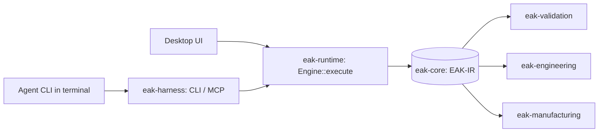

<h1 align="center">EAK — Electronics Agent Kit</h1>

<p align="center"><strong>Intent in. Manufactured board out.</strong></p>

EAK is an AI-native electronics engineering workstation: a native schematic and PCB environment, a
terminal workspace for the coding agents you already use, and a deterministic engineering core. Agents
can propose and edit a structured hardware project through typed commands; EAK's own engines recompute
the numbers and run the checks, so the agent never certifies its own work. It is not a chatbot bolted
onto an EDA tool, and it does not wrap KiCad or EasyEDA.

> **Status: early prototype, source-reviewed only.**
> - **CI proof (GitHub Actions only, nothing is built on a developer laptop):** `cargo fmt --check`,
>   `cargo clippy --workspace --all-targets -- -D warnings`, `cargo test --workspace --locked` on Linux,
>   Windows and macOS (arm64 + x64), plus the frontend typecheck and its 253 vitest tests, passed for
>   commit `b62d0e2` ([run 43733291036](https://github.com/NijoP/electronics-agent-kit-new-prototype/actions/runs/43733291036))
>   and `b096688` ([run 43734737480](https://github.com/NijoP/electronics-agent-kit-new-prototype/actions/runs/43734737480)).
>   That proves it compiles and its tests pass; it does not prove the app was used on real hardware
>   or that any design is correct.
> - Prebuilt downloads exist only as `prebuilt-*` pre-releases made by the release workflow from a
>   CI-green commit (unsigned, SHA-256 checksums and `provenance.json`). The old **v0.1.4** is never used.
> - Nothing EAK produces is manufacturing-ready. Unchecked or unimplemented checks are reported as
>   unknown, never as passing.
>
> Per-feature state: [capability matrix](docs/development/CAPABILITY_GAP_MATRIX.md) · [STATUS.md](STATUS.md).

## Terminal and EDA, one project

The terminal workspace and the schematic/PCB workspace operate on **one** open project and one
revision counter. A coding agent in an EAK terminal uses the `eak` CLI or MCP server; its calls run
as typed commands on the same engine the editor uses, so there is no second design copy.

- **Live refresh.** After an agent commit the editor refreshes by itself, keeping each document's
  camera and your selection (unless the selected part was deleted). Details: ADR-0031, ADR-0036.
- **Agent task status.** Every agent session gets a task record with its starting revision and a phase
  (planning, schematic committed, ERC run, PCB synchronised, placement, routing, DRC run, ...). Phases
  come from what the engine actually executed, never from what the agent says. "Completed" is granted
  only when ERC and DRC evidence supports it, otherwise the task ends "partial". The EDA status bar and
  the terminal workspace show the same revision and phase.
- **ERC gate.** PCB synchronisation is refused (in the editor, the CLI, MCP, the autonomous flow and
  rework) until the schematic is committed and ERC has run on it.
- **Netlist tab.** The bottom panel's Netlist tab shows the engine's own connectivity.

## Install

Installs the newest verified prebuilt release (no compile). One line:

**Linux and macOS**
```bash
curl -fsSL https://github.com/NijoP/electronics-agent-kit-new-prototype/raw/main/install.sh | bash
```
**Windows (PowerShell)**
```powershell
irm https://raw.githubusercontent.com/NijoP/electronics-agent-kit-new-prototype/main/install.ps1 | iex
```

Latest release: [prebuilt-20261115-7c047a1](https://github.com/NijoP/electronics-agent-kit-new-prototype/releases/tag/prebuilt-20261115-7c047a1), built from a commit whose CI was green. The installers are **unsigned**: Windows SmartScreen or macOS Gatekeeper may warn; the installer verifies the SHA-256 checksum. They have not been run on real hardware. More options, update and uninstall are in [Install options](#install-options).

## Prerequisites

- **OS:** Linux x86_64 (Debian/Ubuntu first), Windows 10/11 x64, macOS on Apple silicon or Intel.
- **Tools for the installer:** `curl` (Linux/macOS) or PowerShell 5.1+ (Windows), and internet access to download the release.
- **Linux runtime libraries:** WebKitGTK 4.1 and GTK 3. Debian/Ubuntu: `sudo apt install libwebkit2gtk-4.1-0 libgtk-3-0 libayatana-appindicator3-1`. Fedora: `sudo dnf install webkit2gtk4.1 gtk3 libappindicator-gtk3`.
- **Windows:** the Microsoft Edge WebView2 runtime (already present on current Windows 10/11).
- **macOS:** a macOS version supported by the bundled Tauri webview; not yet checked on a real Mac.
- **Disk and memory:** a few hundred MB for the app; project and cache sizes grow with use. No RAM figure has been measured.
- **Optional:** a coding-agent CLI such as Claude Code for the terminal workspace (EAK never installs or starts one), and model API keys, which are stored in the OS keyring.
- **Not needed** on the prebuilt path: Rust, Node.js, Python or any build tools.


## Honest status

| Area | State |
|---|---|
| Source tree through `5f14256` | **Passed CI on Linux, Windows and macOS (arm64 + x64)**: [run 43804231551](https://github.com/NijoP/electronics-agent-kit-new-prototype/actions/runs/43804231551). Compiles, lints and tests pass; **not runtime-verified on real hardware** |
| Commits after `5f14256` | Not yet confirmed by CI |
| Schematic / PCB editors, terminal workspace, installers | Written and reviewed; never used on real hardware |
| Manufacturing output | Always a draft; nothing is manufacturing-ready |

## Install options

One command installs EAK for your user (the prebuilt release; or, as a fallback, it builds **the current `main` source on your own computer**),
adds a launcher and starts it. Only the source fallback provisions Rust, Node.js and the native build libraries (asking
before anything needs administrator rights).

| Platform | Command |
|---|---|
| Linux (Debian/Ubuntu first) and macOS | `curl -fsSL https://raw.githubusercontent.com/NijoP/electronics-agent-kit-new-prototype/main/install.sh \| bash` |
| Windows 10/11 x64 (PowerShell) | `irm https://raw.githubusercontent.com/NijoP/electronics-agent-kit-new-prototype/main/install.ps1 \| iex` |

- Needs **network access**, and the **first build takes a long time** (the whole Rust dependency tree
  is compiled; plan for tens of minutes). Allow roughly 10 GB of disk (an estimate, not measured).
- The installers themselves have **not been run on real hardware**. Platform matrix:
  [docs/PLATFORM_SUPPORT.md](docs/PLATFORM_SUPPORT.md).
- Pin a revision with `EAK_REF` (tag, branch or commit); the exact commit built is printed. Options,
  install paths, log locations and troubleshooting: [docs/INSTALL.md](docs/INSTALL.md).
- **Prebuilt fast path (default):** when a verified `prebuilt-*` release exists, the installer downloads
  it and checks its SHA-256 before installing; otherwise it says so and builds the source. Force a mode
  with `--source` / `--prebuilt` (Linux/macOS: `... | bash -s -- --source`) or `EAK_INSTALL_MODE`
  (Windows: `$env:EAK_INSTALL_MODE='source'` first). It never installs the old v0.1.4. See
  [docs/INSTALL.md](docs/INSTALL.md#prebuilt-release-the-default-fast-path-when-one-exists).

### Update

Run the same install command again. It rebuilds only if the commit changed, keeps the previous version
until the new one starts, and rolls back if the new one does not start. `EAK_FORCE=1` forces a rebuild.

### Uninstall

Removes only EAK's own app files and launcher, never your projects, settings or credentials. Add
`--clean-cache` (`EAK_CLEAN_CACHE=1`) to also delete build caches.

```bash
curl -fsSL https://raw.githubusercontent.com/NijoP/electronics-agent-kit-new-prototype/main/install.sh | bash -s -- --uninstall
```
```powershell
$env:EAK_UNINSTALL=1; irm https://raw.githubusercontent.com/NijoP/electronics-agent-kit-new-prototype/main/install.ps1 | iex
```

## Build from source manually

For developers with the toolchain already installed: stable Rust 1.80+, Node.js 20.19+ or 22.12+, and
the [Tauri system libraries](https://v2.tauri.app/start/prerequisites/) for your OS. No Python anywhere.
The scripts run `npm ci` and then one `npm run tauri -- build` (never a bare `cargo build --release`,
which skips the frontend build) and print the artifact path:

```bash
./scripts/build.sh      # Linux / macOS
```
```powershell
.\scripts\build.ps1     # Windows
```

Development loop: `cd apps/desktop && npm ci && npm run tauri dev`. Checks before a commit:

```bash
cargo fmt --all -- --check && cargo clippy --workspace --all-targets -- -D warnings \
  && cargo test --workspace --release && bash scripts/check-no-python.sh
```

More: [docs/DEVELOPMENT.md](docs/DEVELOPMENT.md), [TESTING.md](TESTING.md).

## What is in the box

States follow the [capability matrix](docs/development/CAPABILITY_GAP_MATRIX.md). "Reviewed" means read
and statically checked only; nothing here is verified on the current tree.

| Capability | State |
|---|---|
| EAK-IR, typed commands, revisions, undo/redo, journal, crash recovery, project lock | Reviewed; ran before the build freeze |
| Schematic and PCB editors, Project Home, IDE shell | Reviewed; never seen in a real window |
| ERC, DRC, mechanical checks; fail-closed gates (unknown is not pass) | Reviewed; gaps listed in each report |
| Engineering calculators, netlist, native router and placer | Reviewed; heuristic, not signed off |
| Terminal engine (PTY sessions) and terminal workspace UI | PTY tests passed on Linux before the freeze; UI never run |
| `eak` CLI, MCP server, app endpoint for agents | Written; end-to-end tests never run; no agent trialled |
| Optional model providers (Anthropic, OpenAI-compatible, Gemini, Ollama) | Partial; no chat UI |
| Parts search (Distributor), simulation panel (ngspice), library | Partial; not checked against live services |
| 3D board viewer with component models | Written; never rendered |
| Gerber, drill, BOM, CPL, Fabricator preparation | Reviewed; always labelled DRAFT; no fabricator check |
| Agent approval UI, requirements capture, automatic component selection | Planned or partial |
| Independent engineering review, fabricator DFM sign-off | Not done |

## Repository map

| Path | Role |
|---|---|
| `crates/eak-core` | EAK-IR, schema, migration |
| `crates/eak-runtime` | `Engine::execute`, commands, journal, undo, recovery, project lock |
| `crates/eak-engineering` | Calculators, netlist, native router and placer |
| `crates/eak-validation` | ERC, DRC and mechanical checks, fail-closed gates |
| `crates/eak-manufacturing` | Gerber, drill, BOM, CPL, Fabricator preparation (DRAFT) |
| `crates/eak-simulation` | ngspice integration |
| `crates/eak-intelligence` | Optional model providers, typed tools, approvals, knowledge search |
| `crates/eak-terminal` | PTY sessions, process status, local control API |
| `crates/eak-harness` | `eak` CLI, MCP server and app endpoint for agents |
| `apps/desktop` | Tauri 2 shell and React/TypeScript UI (EDA and Terminal workspaces) |
| `scripts/`, `install.sh`, `install.ps1` | Build and source-install scripts |
| `docs/` | Architecture, ADRs, engineering rules, status records |

## Architecture in five bullets



- **One canonical EAK-IR** (`eak-core`). There is no second design representation.
- **Typed, revision-checked commands.** Every change goes through `Engine::execute`; a command that
  carries a stale revision is refused, and nothing writes project files directly.
- **Deterministic validation.** `eak-engineering` recomputes numbers and `eak-validation` runs ERC,
  DRC and mechanical checks. Every report lists what was not implemented and its limitations.
- **A harness for agents.** The `eak` CLI and MCP server expose the same typed commands as the UI, and
  calls are journalled under the agent's name. Agents run with their own installation and login.
- **A terminal workspace.** Real shells on pseudo-terminals with tabs, splits and process-derived
  status, owned by the backend so sessions survive switching workspaces.

## Documentation

- [docs/ARCHITECTURE.md](docs/ARCHITECTURE.md) · [docs/PRODUCT_VISION.md](docs/PRODUCT_VISION.md) · [ROADMAP.md](ROADMAP.md)
- Agents: [docs/AGENT_HARNESS.md](docs/AGENT_HARNESS.md) · [docs/ENGINEERING_API.md](docs/ENGINEERING_API.md) · [docs/TERMINAL_ARCHITECTURE.md](docs/TERMINAL_ARCHITECTURE.md)
- Decisions (ADRs): [docs/decisions](docs/decisions)
- State of the work: [STATUS.md](STATUS.md) · [FEATURE_MATRIX.md](FEATURE_MATRIX.md) · [docs/development/NEXT_ACTION.md](docs/development/NEXT_ACTION.md) · [docs/development/STATIC_REVIEW.md](docs/development/STATIC_REVIEW.md)
- Install and platforms: [docs/INSTALL.md](docs/INSTALL.md) · [docs/PLATFORM_SUPPORT.md](docs/PLATFORM_SUPPORT.md) · [docs/SECURITY.md](docs/SECURITY.md)

## Contributing

Read [AGENTS.md](AGENTS.md): one IR, every mutation through the command engine, no Python, no
unverified claims. Every bug fix needs a regression test; shared-contract changes need an ADR in
[docs/decisions](docs/decisions).

## Licence

Dual licensed under [Apache-2.0](LICENSE-APACHE) or [MIT](LICENSE-MIT), at your option. One small
component derived from an Apache-2.0 project keeps its notices in
[`third_party/licenses/`](third_party/licenses/); see also [LICENSING.md](LICENSING.md) and
[docs/LICENSES_AND_ATTRIBUTION.md](docs/LICENSES_AND_ATTRIBUTION.md).

Developed by Tusk Innovations Global Pvt Ltd. Repository:
<https://github.com/NijoP/electronics-agent-kit-new-prototype>.
