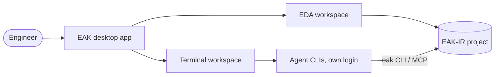
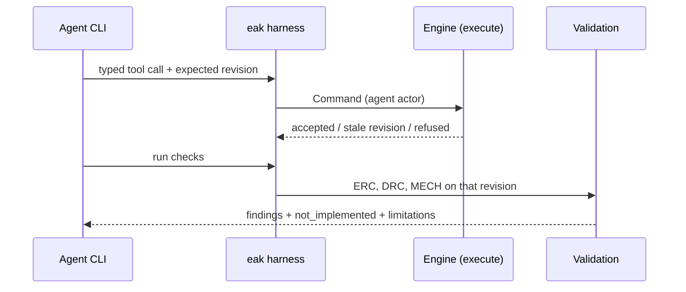
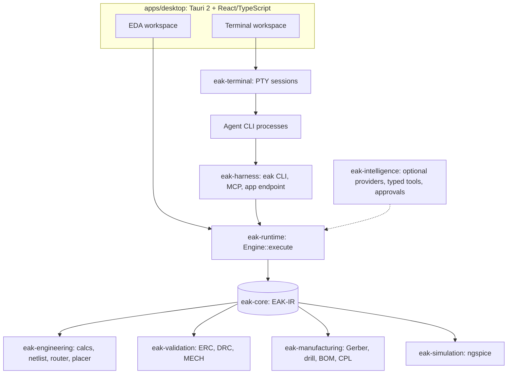
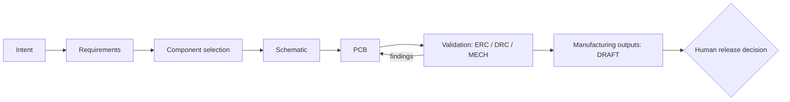

<h1 align="center">EAK — Electronics Agent Kit</h1>

<p align="center"><strong>Intent in. Manufactured board out.</strong></p>

EAK is an AI-native electronics engineering workstation. It joins a native schematic and PCB
environment, a terminal workspace for the coding agents you already use, and a deterministic
engineering core, so that agents can work on a structured hardware project and independent
validation, not the agent, decides whether the work holds up.

It is not a chatbot with a schematic editor attached, and not an AI wrapper around another EDA tool.

> **Early prototype.** Several parts below have been written and reviewed but not yet compiled or
> run. Nothing EAK produces is manufacturing-ready. The [capability matrix](#capabilities-and-status)
> and [STATUS.md](STATUS.md) say exactly what is real.

[Why EAK](#why-eak) · [Workspaces](#two-workspaces) · [Harness](#the-engineering-harness) · [Architecture](#architecture) · [Capabilities](#capabilities-and-status) · [Install](#installation) · [Develop](#developer-setup) · [Roadmap](#roadmap)

## Why EAK

Electronics development is spread across schematic and PCB tools, part libraries, datasheets, BOM
sourcing, validation tools, fabricator portals, and now separate AI coding agents and terminals.
Each handoff is manual and loses context.

EAK connects these through one structured project model (EAK-IR) and one set of typed engineering
operations. Agents become useful in real hardware work without making engineering correctness
depend on an agent's confidence.

**An AI agent must not be the authority that certifies its own engineering work.** Agents can
propose, generate, modify and correct designs. Deterministic EAK engines recompute the numbers and
run the checks, and every report states what it did not check.

## Two workspaces



**EDA workspace.** Project Home, a file explorer, separate schematic and PCB editors over the same
project data, a component library, findings from ERC/DRC/mechanical checks, simulation and
manufacturing panels. Everything is usable by hand; no AI model has to be configured. A 3D board
viewer with real component models is written but has never been built or run.

**Terminal workspace.** A first-class environment, not a panel beside a chat box: real shells on
pseudo-terminals, spaces per project root, tabs, split panes, process-derived status (idle,
running, waiting for input, blocked, done) and sessions owned by the backend so they survive
switching workspaces. Agent CLIs found on the machine are offered as launchers and run with their
own installation and authentication; EAK does not replace them. Claude Code, OpenCode and Pi are
the intended targets, subject to their own compatibility. None has been tested end to end yet.
Persistent processes across an app restart are not implemented. See
[docs/TERMINAL_ARCHITECTURE.md](docs/TERMINAL_ARCHITECTURE.md).

## The engineering harness

Intent → Requirements → Component selection → Schematic → PCB → Validation → Manufacturing.

The harness is how an agent touches a design. The `eak` CLI and an MCP server expose typed tools;
each design change is a typed command carrying the revision the agent last saw, so stale edits are
refused. Calls are journalled under the agent's name and session. EAK's own validators then judge
the result.



Why this shape: revision-aware operations stop agents overwriting each other or the user;
structured state avoids free-text edits to project files; an action and revision history makes
every change traceable; destructive actions need explicit opt-in; and release decisions stay with a
human.

ERC and DRC do **not** prove electrical safety, thermal performance, EMC compliance or
reliability. Those need further engineering analysis and verification that EAK does not perform.

References: [docs/AGENT_HARNESS.md](docs/AGENT_HARNESS.md), [docs/ENGINEERING_API.md](docs/ENGINEERING_API.md).

## Architecture



All design mutations go through `Engine::execute`; nothing writes project files directly.
Details: [docs/ARCHITECTURE.md](docs/ARCHITECTURE.md).

## Capabilities and status

"Implemented" means code exists and its automated tests passed when last run. Work that has only
been read and reviewed is never listed as implemented. Levels of evidence:
[docs/development/TEST_EVIDENCE.md](docs/development/TEST_EVIDENCE.md).

| Capability | Status |
|---|---|
| EAK-IR, typed commands, revisions, undo/redo, journal, crash recovery | Implemented |
| ERC, DRC and mechanical checks with stated gaps | Implemented |
| Engineering calculators, netlist, native router and placer | Implemented |
| Gerber, drill, BOM, CPL, JLCPCB preparation (DRAFT output; nothing is ordered) | Implemented |
| Schematic editor (select, drag, flip, grids) and PCB editor (2–16 layers, align, lock) | Implemented, tested headless; not exercised in a real window |
| IDE shell: workspaces, explorer, multiple projects, Project Home | Implemented, same caveat |
| Library, parts search (LCSC read-only), simulation panel (ngspice) | Partially implemented |
| Terminal engine (PTY sessions, status, local control API) | Partially implemented: PTY tests passed on Linux before the testing freeze |
| Terminal workspace UI | In development: written, never run |
| Engineering harness: `eak` CLI, MCP server, app endpoint | In development: written, never compiled |
| Model providers (Anthropic, OpenAI-compatible, Gemini, Ollama), keys in the OS store | Partially implemented, optional; no chat UI |
| Routing and placement intelligence: congestion-aware pass-based router, selective rip-up, net-priority order, role-based placement | Code-reviewed only; not yet built or run (ADR-0023) |
| Existing-project rework: immutable baseline, protected objects, labelled readiness report | Code-reviewed only; not yet built or run (ADR-0022) |
| Multi-domain engineering model: domains, typed requirements, constraint graph, calculation records, risks | Code-reviewed only; not yet built or run (ADR-0027) |
| Fail-closed validation: every rule is PASS, FAIL or UNKNOWN; stale reports certify UNKNOWN | Code-reviewed only; not yet built or run (ADR-0021, ADR-0026) |
| Autonomous design flow with TTY-only human approval | Code-reviewed only; not yet built or run (ADR-0020) |
| Local knowledge search with source citations; supplier layer with cache, retry and stale-cache fallback | Code-reviewed only; not yet built or run (ADR-0024) |
| Part identity separate from supplier offers, with legacy migration | Code-reviewed only; not yet built or run (ADR-0028) |
| 3D board viewer and real component models (STEP/WRL/GLB) with declared quality labels | Code-reviewed only; not yet built or run (ADR-0025) |
| Performance profile (resource tiers, blocking-pool IPC, per-revision compute) | Code-reviewed only; nothing measured |
| Session context handed to agents, approval UI, agent activity view | Planned |
| Requirements capture and automated component selection | Planned |
| Differential-pair rules, impedance control | Planned |
| Independent engineering review, fabricator DFM sign-off | Not done |

## Recent engineering additions

Everything in this section is **code-reviewed only**: written and read through, never compiled or
run, with nothing measured. Treat it as design intent until the build and tests pass.

- **Routing and placement intelligence.** The native router adds a congestion map, pass-based
  routing with stagnation detection, selective rip-up of lower-priority routes, name-based
  differential-pair adjacency, and current-sized track widths and vias. Power, ground and
  high-current nets route first. Placement follows a hierarchy of mechanical, footprint,
  electrical, functional and routability rules. Read-only harness tools report the analysis. No
  external router is required ([ADR-0023](docs/decisions/0023-routing-intelligence.md)).
- **Existing-project rework.** An agent can inspect an existing design, freeze an immutable
  baseline, protect or accept objects, plan and apply repairs, and produce a labelled readiness
  report. Protected objects are verified by hash after every repair, and a violation undoes the
  repair. Approval is human-only ([ADR-0022](docs/decisions/0022-existing-project-rework.md),
  [docs/agents/REWORK.md](docs/agents/REWORK.md)).
- **Per-domain engineering models.** A domain registry, typed requirements with a knowledge state,
  a constraint graph, calculation records, interactions and risks across electrical, thermal,
  mechanical and other disciplines ([ADR-0027](docs/decisions/0027-multi-domain-engineering-model.md)).
- **Fail-closed validation.** Every rule reports PASS, FAIL or UNKNOWN. Undeclared current,
  voltage or mechanical fit is UNKNOWN, and a report for an older revision certifies nothing
  ([ADR-0021](docs/decisions/0021-fail-closed-engineering-gates.md),
  [ADR-0026](docs/decisions/0026-check-states-and-risk-record.md)). Project Home and the findings
  panel show these states.
- **Knowledge search and suppliers.** Local BM25 search over imported documents returns passages
  with source, page, section and revision, and is advisory only. Supplier lookups go through a
  cache with rate limiting, retry and a labelled stale-cache fallback, and never invent data
  ([ADR-0024](docs/decisions/0024-canonical-state-and-knowledge-architecture.md)).
- **Part identity and supplier offers.** A component's identity is separate from the offers that
  supply it; older project files still load and are migrated
  ([ADR-0028](docs/decisions/0028-supplier-offers-separate-from-identity.md)).
- **3D viewer and component models.** The viewer derives the scene from the project snapshot and
  loads STEP, WRL and GLB models. Each model carries a declared quality (`VENDOR_EXACT`,
  `LIBRARY_VERIFIED`, `DERIVED_VALIDATED`, or "not declared"). EAK does not yet verify model
  geometry against the footprint ([ADR-0025](docs/decisions/0025-component-3d-model-references.md)).
- **Performance work.** A resource profile (auto, low, balanced, high, custom), heavy commands on a
  bounded blocking pool, per-revision compute without the engine lock, and 3D context-loss
  handling. No timings have been measured; see
  [docs/development/PERFORMANCE.md](docs/development/PERFORMANCE.md).

## Engineering workflow



Requirements capture and component selection are planned. Schematic, PCB, validation and
manufacturing outputs exist today. Output stays marked DRAFT unless the checks pass for that exact
revision, and it is never called manufacturing-ready.

## Installation

The goal is a one-minute install. Today it is available for Linux only.

| Platform | Command | Availability |
|---|---|---|
| Linux x86_64 | `curl -fsSL https://raw.githubusercontent.com/NijoP/electronics-agent-kit-new-prototype/main/scripts/install.sh \| bash` | v0.1.4: `.deb` and AppImage (old; does not include current `main`) |
| Windows (PowerShell) | `irm https://raw.githubusercontent.com/NijoP/electronics-agent-kit-new-prototype/main/scripts/install.ps1 \| iex` | **Not yet available**: no Windows package is published; the script stops and says so |
| macOS | same script as Linux | **Not yet available**: no macOS package is published |

The published v0.1.4 (Linux only) predates the terminal workspace, the harness and all the work
listed above. **Current `main` must be built from source**; see [Developer setup](#developer-setup). Windows and macOS packages are pending. Packages are unsigned; installers verify SHA-256 against the
release `SHA256SUMS`. The Linux installer's fallback to v0.1.4's asset names is itself unrun.
Options, paths and uninstall: [docs/INSTALL.md](docs/INSTALL.md).

## Developer setup

Needs stable Rust 1.80+, Node.js 22+, and the Tauri system libraries for your OS
([docs/DEVELOPMENT.md](docs/DEVELOPMENT.md)). No Python anywhere.

```bash
cd apps/desktop && npm ci && npm run tauri dev
cargo fmt --all -- --check && cargo clippy --workspace --all-targets -- -D warnings \
  && cargo test --workspace --release && bash scripts/check-no-python.sh
(cd apps/desktop && npm test)
```

Build from source with the commands above. The integrated tree has not been built yet; expect first-compile fallout.

## Repository structure

| Path | Role |
|---|---|
| `crates/eak-core` | EAK-IR, schema, migration |
| `crates/eak-runtime` | `Engine::execute`, journal, undo, recovery, process supervision |
| `crates/eak-engineering` · `eak-validation` · `eak-manufacturing` · `eak-simulation` | calculators and router · ERC/DRC/MECH · outputs · ngspice |
| `crates/eak-intelligence` | optional model providers, typed tools, approvals |
| `crates/eak-terminal` · `crates/eak-harness` | PTY sessions and control API · `eak` CLI, MCP server, app endpoint |
| `apps/desktop` | Tauri shell and React UI |
| `docs/` | architecture, decisions (ADRs), engineering rules, status records |

## Engineering principles

1. One canonical design model; no second representation.
2. Every mutation is a typed, revision-checked command.
3. Agents never certify their own work; engines recompute and validate.
4. Unknown or unimplemented checks are never reported as passing.
5. Windows, Linux and macOS are equal targets.

## Roadmap

No dates. Detail and states: [ROADMAP.md](ROADMAP.md).

1. **Core engineering foundation**: done.
2. **Independent validation**: rules in place; more rules and external review ahead.
3. **Integrated EDA workspace**: in place; real-window testing ahead; the 3D viewer is written but unbuilt.
4. **Agent-compatible terminal** and **engineering harness**: written; compile, run and trial with real agents next.
5. **Manufacturing workflows**: DRAFT outputs today; fabricator and viewer verification ahead.
6. **Cross-platform distribution**: Linux only; Windows and macOS packages ahead.
7. **Ecosystem integrations**: more suppliers and simulators.

## Contributing

Read [AGENTS.md](AGENTS.md): one IR, every mutation through the command engine, no Python, no
unverified claims. Every bug fix needs a regression test; shared-contract changes need an ADR in
[docs/decisions](docs/decisions). Tests: [TESTING.md](TESTING.md).

## Licensing

Dual licensed under [Apache-2.0](LICENSE-APACHE) or [MIT](LICENSE-MIT), at your option. One small
component derived from an Apache-2.0 open-source project keeps its notices in
[`third_party/licenses/`](third_party/licenses/); dependency licences are in
[LICENSING.md](LICENSING.md) and [docs/LICENSES_AND_ATTRIBUTION.md](docs/LICENSES_AND_ATTRIBUTION.md).

## About

EAK is developed by Tusk Innovations Global Pvt Ltd. Repository:
<https://github.com/NijoP/electronics-agent-kit-new-prototype>.
