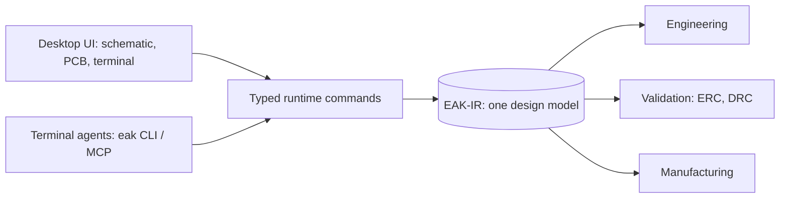

<p align="center">
  
</p>

<h1 align="center">EAK — Electronics Agent Kit</h1>

<p align="center"><strong>Intent in. Manufactured board out.</strong></p>

<p align="center">
An AI-native electronics workstation where a professional schematic/PCB editor and terminal AI agents
share <b>one verifiable design model</b>. Early prototype; open source.
</p>

<p align="center">
  <a href="https://github.com/NijoP/electronics-agent-kit-new-prototype/actions/workflows/ci.yml"></a>
  <a href="https://github.com/NijoP/electronics-agent-kit-new-prototype/releases"></a>
  <a href="LICENSE"></a>
  
  
</p>

<!-- TODO(captain): add a real screenshot or GIF of the running app here, for example
     <p align="center"></p>
     No image is included until a real capture of the current UI exists. -->

## Why EAK

- **Live terminal-to-EDA sync.** A coding agent in EAK's terminal edits the design through typed commands; the schematic and PCB update in front of you, keeping your camera and selection. The terminal and the editor show the same revision and the same agent task phase.
- **Typed, deterministic engine with fail-closed validation.** Every change is a typed command on one design model. ERC, DRC and manufacturing checks are computed by EAK's own engines, never by the agent; unknown or unimplemented checks are reported as unknown, never as passing.
- **Native, vendor-neutral library.** EAK's own component format is the source of truth. "Import from KiCad" is one optional interchange route; EAK never needs KiCad.
- **Any model provider.** Bring the agent CLI you already use, or configure a provider; API keys are stored in your OS keyring, not in project files.
- **Local-first.** Projects are plain folders on your disk. No account, no cloud requirement.

## Install

Installs the newest verified prebuilt release (no compile). One line:

**Linux and macOS**

```bash
curl -fsSL https://raw.githubusercontent.com/NijoP/electronics-agent-kit-new-prototype/main/install.sh | bash
```

**Windows (PowerShell)**

```powershell
irm https://raw.githubusercontent.com/NijoP/electronics-agent-kit-new-prototype/main/install.ps1 | iex
```

Latest prebuilt release: [prebuilt-20261116-66946bd](https://github.com/NijoP/electronics-agent-kit-new-prototype/releases/tag/prebuilt-20261116-66946bd) ([all releases](https://github.com/NijoP/electronics-agent-kit-new-prototype/releases)). The installers are **unsigned**, so Windows SmartScreen or macOS Gatekeeper may warn; the installer verifies the SHA-256 checksum. They have not yet been run on real hardware.

### Prerequisites

| | Needed |
|---|---|
| **OS** | Linux x86_64 (Debian/Ubuntu first), Windows 10/11 x64, macOS (Apple silicon or Intel) |
| **Installer tools** | `curl` (Linux/macOS) or PowerShell 5.1+ (Windows); internet access to download |
| **Linux libraries** | WebKitGTK 4.1 and GTK 3. Debian/Ubuntu: `sudo apt install libwebkit2gtk-4.1-0 libgtk-3-0 libayatana-appindicator3-1`. Fedora: `sudo dnf install webkit2gtk4.1 gtk3 libappindicator-gtk3` |
| **Windows** | Microsoft Edge WebView2 runtime (present on current Windows 10/11) |
| **Optional** | A coding-agent CLI such as Claude Code for the terminal workspace (EAK never installs or starts one); model API keys (stored in the OS keyring) |
| **Not needed** | Rust, Node.js, Python or any build tools on the prebuilt path |

Update by running the same command again. Build from source, uninstall and platform notes: [docs/INSTALL.md](docs/INSTALL.md).

## 60-second quickstart

1. Start EAK and create or open a project folder (**Open project**).
2. Open the **Terminal Workspace** tab and run your agent CLI in the project's space (EAK exports the project and session to it).
3. Ask the agent to build a small circuit with the `eak` CLI or MCP tools. Switch to the **Project / EDA** tab: the schematic appears as it is committed.
4. The agent must run ERC before the PCB is synchronised; the status bar shows the revision and task phase. Then watch placement and routing land on the PCB.
5. Run DRC and open the findings; export is always a draft.

## What works today

| Area | Status |
|---|---|
| Schematic editing (drag-and-drop placement, click-to-place with 'R' rotation, wire, labels, no-connect, mirror, undo/redo) | Beta: reviewed and CI-tested, not used on real hardware |
| PCB editing (outline, footprints, tracks, vias, zones, net highlight, layer manager) | Beta |
| Terminal workspace (spaces, tabs, split panes, agent status) | Beta |
| Terminal-to-EDA live sync, agent task phases, ERC gate | Beta |
| ERC / DRC / DFM with fail-closed reporting | Beta: not all checks exist; gaps are listed in every report |
| Auto-place and auto-route | Beta: EAK's own router; quality not benchmarked |
| Simulation (ngspice) | Beta: needs ngspice installed |
| Manufacturing export (Gerber, drill, BOM, placement) | Beta: always labelled DRAFT |
| Native, vendor-neutral component library and agent acquisition validation | Beta |
| Import from KiCad (symbols .kicad_sym and footprints .kicad_mod, transactional library commit) | Beta |
| Automatic junction dots, Refill zones (recompute connectivity and re-run DRC), PCB net highlighting | Beta |
| Agent orchestration: typed task graph, task journal, scoped context, smart re-runs | Beta |
| Agent orchestration: approval pauses, specialist agents with an independent evaluator, app views | Planned |
| 3D viewer | Beta |
| Netlist import, interactive push-and-shove routing | Planned |
| Licence: [O'Saasy](LICENSE): free to use, modify and self-host; no competing hosted service of EAK itself | In effect |

Nothing EAK produces is manufacturing-ready. CI (Linux, Windows, macOS arm64 and x64) compiles and tests the tree; no area has been verified on real hardware. Details: [STATUS.md](STATUS.md).

## Architecture



One design model, one command boundary: the UI and agents use the same commands, and verification never trusts the agent. More: [docs/ARCHITECTURE.md](docs/ARCHITECTURE.md), [docs/DEVELOPER_OVERVIEW.md](docs/DEVELOPER_OVERVIEW.md).

## Roadmap

See [ROADMAP.md](ROADMAP.md). Near term: netlist import with diagnostics, schematic and PCB polish, more validation rules, signed installers.

## Contributing

Issues and pull requests are welcome: see [CONTRIBUTING.md](CONTRIBUTING.md) and [AGENTS.md](AGENTS.md).

## Licence

[O'Saasy License](LICENSE): free to use, modify and self-host; you may not offer EAK itself as a competing hosted or SaaS product. Releases before this change were MIT OR Apache-2.0. Third-party notices: [third_party/licenses/](third_party/licenses/), [LICENSING.md](LICENSING.md).

---

<p align="center"><b>If EAK looks useful, please star the repo.</b> It helps others find it.</p>
