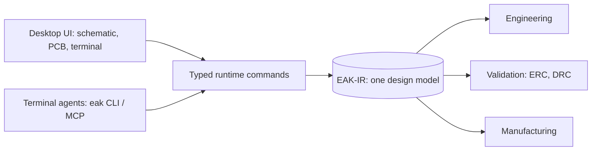

<p align="center">
  
</p>

<h1 align="center">EAK — Electronics Agent Kit</h1>

<p align="center"><strong>Intent in. Manufactured board out.</strong></p>

<p align="center">
An AI-native electronics workstation where a professional schematic/PCB editor and terminal AI agents
share <b>one verifiable design model</b>. Early prototype; open source.
</p>

<p align="center">
  <a href="https://github.com/NijoP/electronics-agent-kit-new-prototype/actions/workflows/ci.yml"></a>
  <a href="https://github.com/NijoP/electronics-agent-kit-new-prototype/releases"></a>
  <a href="LICENSE"></a>
  
  
</p>

<!-- TODO(captain): add a real screenshot or GIF of the running app here, for example
     <p align="center"></p>
     No image is included until a real capture of the current UI exists. -->

## Why EAK

- **Terminal agents and the editor share one design.** A coding agent in EAK's terminal edits the design through the same typed commands as the editor; the schematic and PCB update in front of you, and both show the same revision. Early: complete terminal-to-EDA sync is not done yet (see [Status and limitations](#status-and-limitations)).
- **Typed, deterministic engine with fail-closed validation.** Every change is a typed command on one design model. ERC, DRC and manufacturing checks are computed by EAK's own engines, never by the agent; unknown or unimplemented checks are reported as unknown, never as passing.
- **Native, vendor-neutral library.** EAK's own component format is the source of truth. "Import from KiCad" is one optional interchange route; EAK never needs KiCad.
- **Any model provider.** Bring the agent CLI you already use, or configure a provider; API keys are stored in your OS keyring, not in project files.
- **Local-first.** Projects are plain folders on your disk. No account, no cloud requirement.

## Install

Prebuilt desktop apps come from the [release workflow](.github/workflows/release.yml), which builds each
release on GitHub-hosted runners from one commit whose CI run is green. The commands below install
**[v0.1.5-rc.1](https://github.com/NijoP/electronics-agent-kit-new-prototype/releases/tag/v0.1.5-rc.1)**, a
pre-release; for another release, replace `v0.1.5-rc.1` in the URLs with its tag from the
[releases page](https://github.com/NijoP/electronics-agent-kit-new-prototype/releases).

> **Unsigned builds.** Nothing is code-signed or notarized yet. Windows SmartScreen and macOS Gatekeeper
> will warn; the steps below say how to get past the warning. Check the SHA-256 checksum first (each block
> does). The workflow installs and uninstalls every package on its runner, but the apps have **not been
> launched or tested on real hardware**.

| Platform | Package | Status |
|---|---|---|
| Linux x86_64 (Debian/Ubuntu) | `eak-linux-x86_64.deb` | Built by the release workflow |
| Linux x86_64 (other distributions) | `eak-linux-x86_64.AppImage` | Built by the release workflow |
| Windows 10/11 x64 | `eak-windows-x86_64-setup.exe` (NSIS, per-user) | Built by the release workflow |
| macOS Apple silicon | `eak-macos-aarch64.dmg` | Built by the release workflow |
| macOS Intel | `eak-macos-x86_64.dmg` | Built by the release workflow |
| Linux ARM64, Windows ARM64 | none | **Not supported**: no package is built |

### Linux x86_64: Debian / Ubuntu (.deb)

```bash
cd "$(mktemp -d)"
curl -fLO https://github.com/NijoP/electronics-agent-kit-new-prototype/releases/download/v0.1.5-rc.1/eak-linux-x86_64.deb
curl -fLO https://github.com/NijoP/electronics-agent-kit-new-prototype/releases/download/v0.1.5-rc.1/SHA256SUMS
grep ' eak-linux-x86_64.deb$' SHA256SUMS | sha256sum -c -
sudo apt install ./eak-linux-x86_64.deb
eak-desktop
```

apt installs the WebKitGTK 4.1 and GTK 3 libraries the app needs. Remove it with `sudo apt remove eak`.

### Linux x86_64: other distributions (AppImage)

```bash
mkdir -p ~/Applications && cd ~/Applications
curl -fLO https://github.com/NijoP/electronics-agent-kit-new-prototype/releases/download/v0.1.5-rc.1/eak-linux-x86_64.AppImage
curl -fLO https://github.com/NijoP/electronics-agent-kit-new-prototype/releases/download/v0.1.5-rc.1/SHA256SUMS
grep ' eak-linux-x86_64.AppImage$' SHA256SUMS | sha256sum -c -
chmod +x eak-linux-x86_64.AppImage
./eak-linux-x86_64.AppImage
```

The AppImage needs FUSE 2 (`libfuse2`, `libfuse2t64` on Ubuntu 24.04); without it, run
`./eak-linux-x86_64.AppImage --appimage-extract-and-run`. It also expects WebKitGTK 4.1 and GTK 3 on the
system (Fedora: `sudo dnf install webkit2gtk4.1 gtk3`); this has not been checked on non-Debian distributions.

### Windows 10/11 x64 (PowerShell)

```powershell
cd $env:TEMP
Invoke-WebRequest https://github.com/NijoP/electronics-agent-kit-new-prototype/releases/download/v0.1.5-rc.1/eak-windows-x86_64-setup.exe -OutFile eak-windows-x86_64-setup.exe
Invoke-WebRequest https://github.com/NijoP/electronics-agent-kit-new-prototype/releases/download/v0.1.5-rc.1/SHA256SUMS -OutFile SHA256SUMS
$want = ((Select-String -Path SHA256SUMS -Pattern '[ *]eak-windows-x86_64-setup\.exe$').Line -split '\s+')[0]
if ((Get-FileHash .\eak-windows-x86_64-setup.exe -Algorithm SHA256).Hash -ne $want) { throw 'checksum mismatch: do not run this file' }
.\eak-windows-x86_64-setup.exe
```

The installer is per-user (no administrator rights) and adds EAK to the Start menu; remove it from
**Settings > Apps**. If you downloaded it with a browser instead, SmartScreen shows "Windows protected your
PC": choose **More info > Run anyway**. EAK needs the Microsoft Edge WebView2 runtime, which current
Windows 10/11 already has; the installer downloads it if it is missing.

### macOS (Apple silicon or Intel)

```bash
cd "$(mktemp -d)"
ARCH=$(uname -m | sed 's/arm64/aarch64/')   # aarch64 = Apple silicon, x86_64 = Intel
curl -fLo eak.dmg "https://github.com/NijoP/electronics-agent-kit-new-prototype/releases/download/v0.1.5-rc.1/eak-macos-$ARCH.dmg"
curl -fLO https://github.com/NijoP/electronics-agent-kit-new-prototype/releases/download/v0.1.5-rc.1/SHA256SUMS
echo "$(grep " eak-macos-$ARCH.dmg$" SHA256SUMS | cut -d' ' -f1)  eak.dmg" | shasum -a 256 -c -
mkdir mnt && hdiutil attach eak.dmg -nobrowse -readonly -mountpoint ./mnt
ditto ./mnt/EAK.app /Applications/EAK.app
hdiutil detach ./mnt
xattr -dr com.apple.quarantine /Applications/EAK.app 2>/dev/null || true
open -a EAK
```

Gatekeeper blocks unsigned apps that carry the download quarantine flag (any DMG opened from a browser
download). The `xattr` line removes that flag. If you installed from a browser download instead and macOS
says EAK "cannot be opened" or "is damaged", run that `xattr` line, or open **System Settings > Privacy &
Security** and choose **Open Anyway**. Remove EAK by deleting `/Applications/EAK.app`.

### `eak` CLI and MCP server (optional)

Each release also has `eak-cli-<os>-<arch>` archives (`.tar.gz`; `.zip` on Windows) with the `eak` command and
the `eak-mcp` server for terminal agents. For example on Linux x86_64:

```bash
mkdir -p ~/.local/bin && cd "$(mktemp -d)"
curl -fLO https://github.com/NijoP/electronics-agent-kit-new-prototype/releases/download/v0.1.5-rc.1/eak-cli-linux-x86_64.tar.gz
curl -fLO https://github.com/NijoP/electronics-agent-kit-new-prototype/releases/download/v0.1.5-rc.1/SHA256SUMS
grep ' eak-cli-linux-x86_64.tar.gz$' SHA256SUMS | sha256sum -c -
tar -xzf eak-cli-linux-x86_64.tar.gz -C ~/.local/bin eak eak-mcp
eak --help
```

### One-line installer

`install.sh` / `install.ps1` download the newest `prebuilt-*` release (made by a manual run of the same
workflow), verify its checksum, install it per user and check that it starts. When no prebuilt release
exists they build from source instead. Details, options and uninstall: [docs/INSTALL.md](docs/INSTALL.md).

```bash
curl -fsSL https://raw.githubusercontent.com/NijoP/electronics-agent-kit-new-prototype/main/install.sh | bash
```

```powershell
irm https://raw.githubusercontent.com/NijoP/electronics-agent-kit-new-prototype/main/install.ps1 | iex
```

### Build from source (contributors)

For working on EAK, not for using it. Needs Rust stable (1.80+), Node.js 20.19+ or 22.12+ (CI uses 24) and
on Linux the Tauri libraries
(`sudo apt install libwebkit2gtk-4.1-dev libgtk-3-dev libayatana-appindicator3-dev librsvg2-dev libdbus-1-dev libssl-dev pkg-config`);
on Windows the MSVC Build Tools and WebView2; on macOS the Xcode Command Line Tools.

```bash
git clone https://github.com/NijoP/electronics-agent-kit-new-prototype.git
cd electronics-agent-kit-new-prototype/apps/desktop
npm ci
npm run tauri dev            # run the app in development mode
npm run tauri -- build       # or build installable bundles into target/release/bundle
```

Checks to run before a pull request: `cargo fmt --all -- --check`, `cargo clippy --workspace --all-targets -- -D warnings`,
`cargo test --workspace --release`, and `npm run typecheck && npm test` in `apps/desktop`. More:
[CONTRIBUTING.md](CONTRIBUTING.md), [docs/DEVELOPMENT.md](docs/DEVELOPMENT.md).

## 60-second quickstart

1. Start EAK and create or open a project folder (**Open project**).
2. Open the **Terminal Workspace** tab and run your agent CLI in the project's space (EAK exports the project and session to it).
3. Ask the agent to build a small circuit with the `eak` CLI or MCP tools. Switch to the **Project / EDA** tab: the schematic appears as it is committed.
4. The agent must run ERC before the PCB is synchronised; the status bar shows the revision and task phase. Then watch placement and routing land on the PCB.
5. Run DRC and open the findings; export is always a draft.

## Status and limitations

EAK is an early prototype. Phase 1, the **EDA workspace** (schematic and PCB editors, design rules,
checks, outputs and 3D view inside the IDE shell), is done: built and tested by CI on Linux, Windows and
macOS, but not used for a real board yet. **Not done yet:** WEFT agent orchestration (approval pauses,
specialist agents with an independent evaluator) and complete terminal-to-EDA sync; the pieces that exist
are listed below as Beta. Builds are unsigned, and nothing EAK produces is manufacturing-ready.

## What works today

| Area | Status |
|---|---|
| Schematic editing (drag-and-drop placement, click-to-place with 'R' rotation, wire, labels, no-connect, mirror, undo/redo) | Beta: reviewed and CI-tested, not used on real hardware |
| PCB editing (outline, footprints, tracks, vias, zones, net highlight, layer manager) | Beta |
| Terminal workspace (spaces, tabs, split panes, agent status) | Beta |
| Terminal-to-EDA live sync, agent task phases, ERC gate | Beta |
| ERC / DRC / DFM with fail-closed reporting | Beta: not all checks exist; gaps are listed in every report |
| Auto-place and auto-route | Beta: EAK's own router; quality not benchmarked |
| Simulation (ngspice) | Beta: needs ngspice installed |
| Manufacturing export (Gerber, drill, BOM, placement) | Beta: always labelled DRAFT |
| Native, vendor-neutral component library and agent acquisition validation | Beta |
| Import from KiCad (symbols .kicad_sym and footprints .kicad_mod, transactional library commit) | Beta |
| Automatic junction dots, Refill zones (recompute connectivity and re-run DRC), PCB net highlighting | Beta |
| Agent orchestration: typed task graph, task journal, scoped context, smart re-runs | Beta |
| Agent orchestration: approval pauses, specialist agents with an independent evaluator, app views | Planned |
| 3D viewer | Beta |
| Netlist import, interactive push-and-shove routing | Planned |
| Licence: [O'Saasy](LICENSE): free to use, modify and self-host; no competing hosted service of EAK itself | In effect |

Nothing EAK produces is manufacturing-ready. CI (Linux, Windows, macOS arm64 and x64) compiles and tests the tree; no area has been verified on real hardware. Details: [STATUS.md](STATUS.md).

## Architecture



One design model, one command boundary: the UI and agents use the same commands, and verification never trusts the agent. More: [docs/ARCHITECTURE.md](docs/ARCHITECTURE.md), [docs/DEVELOPER_OVERVIEW.md](docs/DEVELOPER_OVERVIEW.md).

## Roadmap

See [ROADMAP.md](ROADMAP.md). Near term: netlist import with diagnostics, schematic and PCB polish, more validation rules, signed installers.

## Contributing

Issues and pull requests are welcome: see [CONTRIBUTING.md](CONTRIBUTING.md) and [AGENTS.md](AGENTS.md).

## Licence

[O'Saasy License](LICENSE): free to use, modify and self-host; you may not offer EAK itself as a competing hosted or SaaS product. Releases before this change were MIT OR Apache-2.0. Third-party notices: [third_party/licenses/](third_party/licenses/), [LICENSING.md](LICENSING.md).

---

<p align="center"><b>If EAK looks useful, please star the repo.</b> It helps others find it.</p>
