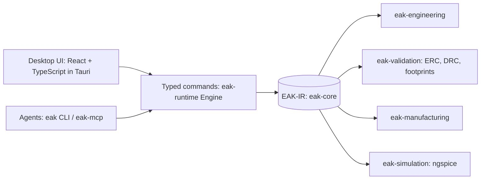

<p align="center">
  
</p>

<h1 align="center">EAK — Electronics Agent Kit</h1>

<p align="center"><strong>Intent in. Manufactured board out.</strong></p>

<p align="center">
An open-source desktop electronics workstation: schematic capture, PCB layout, verification and
manufacturing outputs on <b>one verifiable design model</b>, which terminal AI agents edit through the
same typed commands as the editor. Pre-release software, not yet proven on real hardware.
</p>

<p align="center">
  <a href="https://github.com/NijoP/electronics-agent-kit-new-prototype/actions/workflows/ci.yml"></a>
  <a href="https://github.com/NijoP/electronics-agent-kit-new-prototype/releases"></a>
  <a href="LICENSE"></a>
  
</p>

Execution roadmap (goals, owners, evidence, completion marks): [ROADMAP_EXECUTION.md](ROADMAP_EXECUTION.md).

## Contents

- [What EAK is](#what-eak-is)
- [The design workflow, stage by stage](#the-design-workflow-stage-by-stage)
- [Benefits](#benefits)
- [Features and limitations](#features-and-limitations)
- [Install](#install)
- [Getting started](#getting-started)
- [Using EAK](#using-eak)
- [Architecture](#architecture)
- [Developer guide](#developer-guide)
- [Roadmap](#roadmap)
- [Documentation](#documentation)
- [Contributing, licence and support](#contributing-licence-and-support)

## What EAK is

Board design today is spread over separate tools: a schematic/PCB editor, datasheet PDFs, distributor
sites, calculators and spreadsheets, a simulator, a fabricator's upload form, and, more and more, an AI
assistant that sees none of them. The design intent is re-typed between them, and nothing checks that
they still agree.

EAK puts these steps on one design model, **EAK-IR** (`crates/eak-core`):

- The desktop editor, the `eak` command line and AI agents (through the `eak-mcp` server) all change
  the design with the same typed commands, through one engine (`eak_runtime::Engine::execute`). There
  is no second copy of the design to drift.
- Checks are computed by EAK's own engines (`eak-validation`, `eak-engineering`), never by the AI. A
  check that is not implemented, or whose inputs are missing, reports **UNKNOWN** or **BLOCKED**, never
  PASS. Every report lists `not_implemented` and `limitations`.
- Projects are plain folders on your disk. No account, no cloud service, and no dependency on KiCad,
  EasyEDA or an external router.

**"Intent in. Manufactured board out."** is the product direction: you state what the board must do, and
EAK carries the design through schematic, layout, verification and fabrication files with each step
checked. In practical terms, today: an engineer, or an agent the engineer supervises, can capture a
schematic, run ERC, synchronise the PCB, place and route interactively, run DRC, and export **draft**
Gerber, drill, BOM and placement files. The steps between "intent" and "schematic" (requirements,
part selection, datasheet verification) and a board made and measured from EAK output are **not done**.
EAK never calls a design manufacturing-ready.

Current state: **v0.2.0-rc.1**, an unsigned pre-release. Exact per-feature status:
[docs/RELEASE_STATUS_v0.2.0.md](docs/RELEASE_STATUS_v0.2.0.md).

## The design workflow, stage by stage

Status words: **works** = merged and covered by CI tests (and a real-window scenario where noted in the
release status); **partial** = part of it is reachable; **not implemented** = not in the app.

| # | Stage | Traditional way | EAK today | Benefit, where it exists |
|---|---|---|---|---|
| 1 | Requirements | Notes, e-mail, a spec document | **Partial.** Project Home holds a design brief and project facts. No requirements-to-design tracing | The brief lives with the project |
| 2 | Component research | Distributor sites, parametric search | **Partial.** Native library with search (local SQLite database), KiCad library folder import. MPN discovery and a CSV/JSON part-list source exist in the engine with no UI. **No live distributor connection** (the LCSC source is a slot marked not connected) | One vendor-neutral library format |
| 3 | Datasheet verification | Reading PDFs by hand, checking pinouts and land patterns | **Partial.** Footprint checks FP-001..FP-010 and pin-to-pad checks (PP-001..) run and show in the Library panel. Datasheet references and typed specs are engine-only. EAK does **not** read a datasheet and confirm a part against it | Unverified footprints block the release check |
| 4 | Schematic capture | Editor | **Works.** Multi-sheet capture, power ports, labels, buses, off-page connectors, annotation, groups, find, copy/paste | Agent and engineer edit the same sheet through the same commands |
| 5 | Connectivity (ERC) | Editor ERC, manual review | **Works.** Unconnected pins, drivers, pin-conflict matrix, undriven inputs, power nets, capacitor voltage rating, bus and off-page rules; per-rule severity; findings link to objects | An agent must pass the ERC gate before PCB sync |
| 6 | Placement and routing | Manual placement, interactive routing, external autorouter | **Partial.** Interactive routing (width/via presets, walk-around, block, push-and-shove, 45/90°, layer switch with via), auto-place, 2-16 layer stack-up, zones and planes. **No complete multilayer autorouter**: the autorouter in the release does no via or layer-transition routing | One board geometry feeds DRC, connectivity, 2D and 3D |
| 7 | DRC and engineering verification | Editor DRC plus calculators and spreadsheets | **Partial.** DRC with a clearance matrix, net-pair rules, mask/paste expansion, thermal reliefs and zone fill. **No complete electrical, thermal, high-voltage, RF or mechanical verification suite**; those engines are under active development | Missing inputs give UNKNOWN/BLOCKED, never a silent pass |
| 8 | 2D / 3D review | Editor viewers, MCAD export | **Works, with limits.** 2D canvas and a 3D view with presets, measure and cross-probe. 3D draws arc tracks straight and ignores arc edges and cut-outs. No MCAD (STEP) exchange | Cross-probe between schematic, PCB and 3D |
| 9 | BOM and manufacturing | Plot Gerbers, export BOM/CPL, upload | **Works as DRAFT.** Gerber, drill, BOM (CSV/XLSX), placement, IPC-D-356 and JSON netlists, schematic PDF/SVG, release check with fail-closed gates. Packages stay draft: land-pattern tables are not in the release gate | Output is bound to a design revision; Gerber and drill are parsed back in CI |
| 10 | Review, revision, handoff | Screenshots, e-mail, version control by hand | **Partial.** Agent changes arrive as proposals, checked on a copy and applied only by a person. Problems panel and journey bar. No multi-user review or design diff view | A person approves every agent change |

No board has been manufactured from EAK output. Treat every output as a draft to be checked in your
usual tools.

## Benefits

**Demonstrated** (by tests in this repository, not by hardware):

- **One model, one command path.** UI, CLI and agents cannot diverge, because all three call the same
  engine. Proved by the harness end-to-end tests (`crates/eak-harness/tests/`).
- **Fail-closed checks.** Unknown rules show as UNKNOWN and block the release check (ADR-0048).
- **Supervised AI.** In propose mode an agent cannot change the design; it files a proposal that a
  person reviews and applies (`crates/eak-harness/tests/proposal.rs`, ui-evidence `g4-proposal.json`).
- **Local and vendor-neutral.** Plain project folders, native library format, optional KiCad import;
  API keys go to the OS keyring.
- **Three platforms from one codebase.** CI builds and tests on Linux, Windows, macOS arm64 and x64.

**Expected, not yet demonstrated:**

- Shorter time from requirement to fabrication files. Not measured.
- Fewer respins through engineering verification. The verification suite is incomplete.
- Correct fabricated boards. No hardware has been built.

## Features and limitations

Full tables: [docs/RELEASE_STATUS_v0.2.0.md](docs/RELEASE_STATUS_v0.2.0.md), [STATUS.md](STATUS.md),
[FEATURE_MATRIX.md](FEATURE_MATRIX.md). "Tested" below means CI tests, plus real-window scenarios on
Linux under Xvfb where [docs/qa/UI_EVIDENCE.md](docs/qa/UI_EVIDENCE.md) lists one; 37 scenarios drive the app in a real window.

| Area | Implemented | Limits |
|---|---|---|
| Shell | Navigation rail (Home, Schematic, PCB, 3D, Library, Agents, Checks, Manufacturing, Terminal), explorer, document tabs, command palette, Project Home with first-run tour, journey bar, Problems panel | The Agents rail item opens Model settings; there is no agent panel in the EDA workspace yet |
| Schematic | Multi-sheet capture, library-drawn symbols, place tools, annotate, groups, net-label rename | Schematic PDF fonts are not embedded |
| ERC | Rule set above, per-rule enable and severity, CSV/JSON export of findings | Not every electrical rule exists; see the report's `not_implemented` |
| Schematic → PCB | Update PCB with an ECO preview, partial apply, undo | |
| PCB | Outline with arcs, footprints, tracks, arc tracks, vias, zones, planes, keep-outs, cut-outs, text, dimensions, layer manager | Keep-outs, cut-outs and dimensions can be drawn and deleted but not selected or edited. The route tool draws no arc corners |
| Routing | Interactive routing with push-and-shove; auto-route and rip-up/re-route | No complete multilayer autorouter. Released autorouter: no via or layer-transition routing |
| DRC and rules | Rule configuration, clearance matrix, net-pair rules, real-time DRC, zone fill, stitching, dead-copper removal | Incomplete rule coverage; UNKNOWN is shown, never PASS |
| Stack-up | 2-16 layers, via spans, editable stack-up, plane fills | Stack-up impedance estimates (IPC-2141A) and schema v8 fields for differential pairs and target impedance are on `main` after the rc.1 commit, as engine and data-model work; they report UNKNOWN on missing input |
| Library | Native library with scopes, symbol and footprint editors, personal-library component create/edit, KiCad library folder import, database search, footprint and pin-to-pad verification | MPN discovery, datasheet specs, library export/import, part-list sources: engine only. No distributor connection |
| Manufacturing | Gerber, drill, BOM, placement, netlists, PDF/SVG, release check, revision-bound packaging | Always DRAFT. Gerber/drill read-back runs only in CI |
| 3D | 3D document view, presets, orthographic, measure, cross-probe | Arc tracks drawn straight; cut-outs ignored |
| Simulation | ngspice netlist simulation | Needs ngspice installed |
| Terminal | Spaces bound to projects, tabs, split panes, agent detection | |
| Agent harness | `eak` CLI, `eak-mcp` server, engineering gates (PASS/FAIL/UNKNOWN/NOT_RUN), task graph and journal, propose mode, WEFT agent-to-agent orchestration over CLI and MCP | The in-app WEFT activity view is finished but not merged |
| AI tools | Settings › AI tools detects Claude Code and Codex, starts sessions in propose mode, live log, Restart | **Tested only against fake binaries**, never a real installed Claude Code or Codex. No OpenCode or Gemini adapters. Restart starts a fresh session. Reached only from rail › Preferences while a project is open (known bug) |

Other limits: nothing is code-signed or notarized; no Linux arm64 or Windows arm64 build; no netlist
import; nothing has been tested on real hardware.

## Install

### Supported platforms

| Platform | Package | CLI archive |
|---|---|---|
| Linux x86_64, Debian/Ubuntu | `eak-linux-x86_64.deb` | `eak-cli-linux-x86_64.tar.gz` |
| Linux x86_64, other distributions | `eak-linux-x86_64.AppImage` | same |
| Windows 10/11 x64 | `eak-windows-x86_64-setup.exe` (NSIS, per-user) | `eak-cli-windows-x86_64.zip` |
| macOS Apple silicon | `eak-macos-aarch64.dmg` | `eak-cli-macos-aarch64.tar.gz` |
| macOS Intel | `eak-macos-x86_64.dmg` | `eak-cli-macos-x86_64.tar.gz` |
| Linux arm64, Windows arm64 | none: not supported | none |

### What has and has not been tested

| Tier | What | State |
|---|---|---|
| 1 | Packages built by [`release.yml`](.github/workflows/release.yml) from a CI-green commit, checksummed, installed and uninstalled on the GitHub runner | Done for every release build |
| 2 | Manual test by the founder on real machines: launch, open a project, main flows | **Pending** |
| 3 | One-line installers `install.sh` / `install.ps1` | **Code-reviewed only, never run** ([docs/PLATFORM_SUPPORT.md](docs/PLATFORM_SUPPORT.md)) |

> **Unsigned builds.** Windows SmartScreen and macOS Gatekeeper will warn. Verify the SHA-256 checksum
> first; each block below does.

> **Release.** The commands below install
> [`v0.2.0-rc.1`](https://github.com/NijoP/electronics-agent-kit-new-prototype/releases/tag/v0.2.0-rc.1),
> an unsigned pre-release. For another release, replace the tag in the URLs with one from the
> [releases page](https://github.com/NijoP/electronics-agent-kit-new-prototype/releases).

### Linux x86_64: Debian / Ubuntu (.deb)

```bash
cd "$(mktemp -d)"
curl -fLO https://github.com/NijoP/electronics-agent-kit-new-prototype/releases/download/v0.2.0-rc.1/eak-linux-x86_64.deb
curl -fLO https://github.com/NijoP/electronics-agent-kit-new-prototype/releases/download/v0.2.0-rc.1/SHA256SUMS
grep ' eak-linux-x86_64.deb$' SHA256SUMS | sha256sum -c -
sudo apt install ./eak-linux-x86_64.deb
eak-desktop
```

apt installs the WebKitGTK 4.1 and GTK 3 libraries the app needs. Uninstall: `sudo apt remove eak`.

### Linux x86_64: other distributions (AppImage)

```bash
mkdir -p ~/Applications && cd ~/Applications
curl -fLO https://github.com/NijoP/electronics-agent-kit-new-prototype/releases/download/v0.2.0-rc.1/eak-linux-x86_64.AppImage
curl -fLO https://github.com/NijoP/electronics-agent-kit-new-prototype/releases/download/v0.2.0-rc.1/SHA256SUMS
grep ' eak-linux-x86_64.AppImage$' SHA256SUMS | sha256sum -c -
chmod +x eak-linux-x86_64.AppImage
./eak-linux-x86_64.AppImage
```

Needs FUSE 2 (`libfuse2`; `libfuse2t64` on Ubuntu 24.04), or run it with `--appimage-extract-and-run`.
It expects WebKitGTK 4.1 and GTK 3 on the system (Fedora: `sudo dnf install webkit2gtk4.1 gtk3`); this
has not been checked on non-Debian distributions. Uninstall: delete the file.

### Windows 10/11 x64 (PowerShell)

```powershell
cd $env:TEMP
Invoke-WebRequest https://github.com/NijoP/electronics-agent-kit-new-prototype/releases/download/v0.2.0-rc.1/eak-windows-x86_64-setup.exe -OutFile eak-windows-x86_64-setup.exe
Invoke-WebRequest https://github.com/NijoP/electronics-agent-kit-new-prototype/releases/download/v0.2.0-rc.1/SHA256SUMS -OutFile SHA256SUMS
$want = ((Select-String -Path SHA256SUMS -Pattern '[ *]eak-windows-x86_64-setup\.exe$').Line -split '\s+')[0]
if ((Get-FileHash .\eak-windows-x86_64-setup.exe -Algorithm SHA256).Hash -ne $want) { throw 'checksum mismatch: do not run this file' }
.\eak-windows-x86_64-setup.exe
```

Per-user install, no administrator rights; EAK appears in the Start menu. If SmartScreen shows "Windows
protected your PC", choose **More info > Run anyway**. EAK needs the Microsoft Edge WebView2 runtime;
the installer downloads it if it is missing. Uninstall: **Settings > Apps**.

### macOS (Apple silicon or Intel)

```bash
cd "$(mktemp -d)"
ARCH=$(uname -m | sed 's/arm64/aarch64/')   # aarch64 = Apple silicon, x86_64 = Intel
curl -fLo eak.dmg "https://github.com/NijoP/electronics-agent-kit-new-prototype/releases/download/v0.2.0-rc.1/eak-macos-$ARCH.dmg"
curl -fLO https://github.com/NijoP/electronics-agent-kit-new-prototype/releases/download/v0.2.0-rc.1/SHA256SUMS
echo "$(grep " eak-macos-$ARCH.dmg$" SHA256SUMS | cut -d' ' -f1)  eak.dmg" | shasum -a 256 -c -
mkdir mnt && hdiutil attach eak.dmg -nobrowse -readonly -mountpoint ./mnt
ditto ./mnt/EAK.app /Applications/EAK.app
hdiutil detach ./mnt
xattr -dr com.apple.quarantine /Applications/EAK.app 2>/dev/null || true
open -a EAK
```

If macOS says EAK "cannot be opened" or "is damaged", run the `xattr` line, or use **System Settings >
Privacy & Security > Open Anyway**. Uninstall: delete `/Applications/EAK.app`.

### `eak` CLI and MCP server (for terminal agents)

```bash
mkdir -p ~/.local/bin && cd "$(mktemp -d)"
curl -fLO https://github.com/NijoP/electronics-agent-kit-new-prototype/releases/download/v0.2.0-rc.1/eak-cli-linux-x86_64.tar.gz
curl -fLO https://github.com/NijoP/electronics-agent-kit-new-prototype/releases/download/v0.2.0-rc.1/SHA256SUMS
grep ' eak-cli-linux-x86_64.tar.gz$' SHA256SUMS | sha256sum -c -
tar -xzf eak-cli-linux-x86_64.tar.gz -C ~/.local/bin eak eak-mcp
eak --help
```

### Install scripts (build from source on your machine)

`install.sh` and `install.ps1` resolve a commit (`EAK_REF`, default `main`), provision Rust and Node.js
if needed, build the app locally and install it per user. The first build compiles the whole Rust
dependency tree and takes a long time. **These scripts are code-reviewed only and have never been run
end to end**; treat a first run as a test. Options, update and uninstall:
[docs/INSTALL.md](docs/INSTALL.md).

```bash
curl -fsSL https://raw.githubusercontent.com/NijoP/electronics-agent-kit-new-prototype/main/install.sh | bash
```

```powershell
irm https://raw.githubusercontent.com/NijoP/electronics-agent-kit-new-prototype/main/install.ps1 | iex
```

### Update

Install the newer package over the old one with the same steps. There is no in-app updater.

### Troubleshooting

| Symptom | Cause and fix |
|---|---|
| `curl: (22) ... 404` | The tag in the URL is not published; use a tag listed on the releases page |
| Checksum mismatch | Do not run the file; download again |
| AppImage will not start | Install `libfuse2`, or add `--appimage-extract-and-run` |
| Blank window on Linux | WebKitGTK 4.1 or GTK 3 missing |
| macOS "damaged" or "cannot be opened" | Quarantine flag on an unsigned app: run the `xattr` line |
| Windows SmartScreen warning | Unsigned installer: **More info > Run anyway** after the checksum passes |
| Settings › AI tools shows "Not found" | `claude` or `codex` is not on `PATH` |

## Getting started

1. Start EAK. Project Home opens with a first-run tour.
2. Create a project or open a project folder.
3. **Schematic** (rail): place parts from the library dock, wire them, add power ports and labels.
4. **Checks**: run ERC and fix the findings; each finding links to its object.
5. Run **Update PCB** and review the ECO preview before applying it.
6. **PCB**: draw the board outline, place footprints, route with the Route tool, pour zones.
7. **Checks**: run DRC. UNKNOWN means EAK could not check a rule, not that it passed.
8. **Manufacturing**: run the Release check and export. Every output is labelled DRAFT.

To work with an agent instead: open the **Terminal**, start your agent CLI in the project's space, and
let it use the `eak` CLI or the `eak-mcp` tools. In propose mode (`eak --propose`, or a session started
from Settings › AI tools) its changes arrive as proposals; review them with the **Review agent
proposals…** action in the command palette.

## Using EAK

| Rail item | Use |
|---|---|
| Home | Project facts, Needs attention, design brief |
| Schematic | Capture, sheets, annotate, find |
| PCB | Outline, placement, routing, zones, layer manager, stack-up (2-16 layers, via spans) |
| 3D | Board view, measure, cross-probe |
| Library | Search, personal-library component create/edit, symbol and footprint editors, KiCad folder import, footprint and pin-to-pad verification reports |
| Agents | Opens Model settings (provider catalog, connection test; keys in the OS keyring) |
| Checks | ERC and DRC findings, per-rule enable and severity, CSV/JSON export |
| Manufacturing | Gerber, drill, BOM, placement, netlists, PDF/SVG, Release check |
| Terminal | Spaces bound to projects, tabs, split panes, agent sessions |

- **Projects** are folders; copy, version or share them like any directory. EAK writes them only
  through its command engine.
- **AI tools (Claude Code, Codex):** open a project, then rail › Preferences › AI tools. EAK detects
  the installed CLIs, starts a session in propose mode and shows its log. Not yet tested against the
  real tools.
- **Agent reference:** [docs/AGENT_HARNESS.md](docs/AGENT_HARNESS.md),
  [docs/ENGINEERING_API.md](docs/ENGINEERING_API.md), [docs/terminal-api.md](docs/terminal-api.md).

No screenshots are included: the captures in the repository predate the current interface, and this
README shows only real, current ones.

## Architecture



| Path | Role |
|---|---|
| `crates/eak-core` | EAK-IR: the one design model and its schema |
| `crates/eak-runtime` | Command engine, deltas, project store |
| `crates/eak-engineering` | Engineering calculations; recomputes every number an agent supplies |
| `crates/eak-validation` | ERC, DRC, footprint and pin-to-pad verification |
| `crates/eak-manufacturing` | Gerber, drill, BOM, placement, release integrity |
| `crates/eak-simulation` | ngspice netlist simulation |
| `crates/eak-library` | Part model, sources, KiCad import/export, library database |
| `crates/eak-terminal` | PTY sessions, status, control API |
| `crates/eak-harness` | `eak` CLI, `eak-mcp` server, app endpoint |
| `crates/eak-agents` | Claude Code and Codex adapters |
| `crates/eak-intelligence` | Optional model providers, typed tools, approvals |
| `apps/desktop` | Tauri desktop app: Rust backend (`src-tauri`), React/TypeScript UI (`src`) |

Rules the code enforces: one design representation; every mutation is a typed `Command`; no Python
(`scripts/check-no-python.sh`); the AI never certifies its own work. More:
[docs/ARCHITECTURE.md](docs/ARCHITECTURE.md), [docs/DEVELOPER_OVERVIEW.md](docs/DEVELOPER_OVERVIEW.md),
[docs/TERMINAL_ARCHITECTURE.md](docs/TERMINAL_ARCHITECTURE.md), decisions in
[docs/decisions/](docs/decisions/).

## Developer guide

Prerequisites: Rust stable (1.80+), Node.js 20.19+ or 22.12+. Linux:
`sudo apt install libwebkit2gtk-4.1-dev libgtk-3-dev libayatana-appindicator3-dev librsvg2-dev libdbus-1-dev libssl-dev pkg-config`.
Windows: MSVC Build Tools and WebView2. macOS: Xcode Command Line Tools.

```bash
git clone https://github.com/NijoP/electronics-agent-kit-new-prototype.git
cd electronics-agent-kit-new-prototype/apps/desktop
npm ci
npm run tauri dev            # run the app in development mode
npm run tauri -- build       # build bundles into target/release/bundle
```

Before a pull request, from the repository root:

```bash
cargo fmt --all -- --check
cargo clippy --workspace --all-targets -- -D warnings
cargo test --workspace --release
(cd apps/desktop && npm run typecheck && npm test)
```

Guides: [CONTRIBUTING.md](CONTRIBUTING.md), [AGENTS.md](AGENTS.md),
[docs/DEVELOPMENT.md](docs/DEVELOPMENT.md), [TESTING.md](TESTING.md).

## Roadmap

| State | Items |
|---|---|
| Completed and CI-verified | EDA workspace (schematic, PCB, ERC/DRC, library, outputs, 3D); v2 shell and Project Home; propose mode and proposal review; footprint and pin-to-pad verification; release integrity; KiCad library folder import |
| Partial | AI tool adapters (fake-binary tests only); WEFT orchestration (CLI/MCP only); part model, MPN discovery, datasheet specs and part sources (engine only) |
| Active development | Multilayer autorouter on the real stack-up; differential pairs and stack-up impedance; engineering verification engines; WEFT activity view. None is complete, and none is marked complete until its acceptance tests pass |
| Planned | Signed and notarized installers; netlist import; live distributor sources; an in-app agent panel; arm64 Linux and Windows builds |
| Not started | A fabricated, measured board from EAK output |

Detail: [ROADMAP.md](ROADMAP.md), [CHANGELOG.md](CHANGELOG.md).

## Documentation

| Topic | Document |
|---|---|
| Release status | [docs/RELEASE_STATUS_v0.2.0.md](docs/RELEASE_STATUS_v0.2.0.md), [STATUS.md](STATUS.md), [FEATURE_MATRIX.md](FEATURE_MATRIX.md) |
| Install and platforms | [docs/INSTALL.md](docs/INSTALL.md), [docs/PLATFORM_SUPPORT.md](docs/PLATFORM_SUPPORT.md) |
| Product vision | [docs/PRODUCT_VISION.md](docs/PRODUCT_VISION.md) |
| Architecture | [docs/ARCHITECTURE.md](docs/ARCHITECTURE.md), [docs/DEVELOPER_OVERVIEW.md](docs/DEVELOPER_OVERVIEW.md) |
| Agents and APIs | [docs/AGENT_HARNESS.md](docs/AGENT_HARNESS.md), [docs/ENGINEERING_API.md](docs/ENGINEERING_API.md), [docs/terminal-api.md](docs/terminal-api.md) |
| Test evidence | [docs/qa/UI_EVIDENCE.md](docs/qa/UI_EVIDENCE.md), [docs/qa/UI_INVENTORY.md](docs/qa/UI_INVENTORY.md), [TESTING.md](TESTING.md) |
| Requirements traceability | [docs/REQUIREMENTS_TRACEABILITY.md](docs/REQUIREMENTS_TRACEABILITY.md) |
| Security | [docs/SECURITY.md](docs/SECURITY.md) |

## Contributing, licence and support

Issues and pull requests are welcome: [CONTRIBUTING.md](CONTRIBUTING.md). Report bugs and ask questions
in [GitHub issues](https://github.com/NijoP/electronics-agent-kit-new-prototype/issues).

[O'Saasy License](LICENSE): free to use, modify and self-host; you may not offer EAK itself as a
competing hosted or SaaS product. Releases before the licence change were MIT OR Apache-2.0.
Third-party notices: [third_party/licenses/](third_party/licenses/), [LICENSING.md](LICENSING.md).
