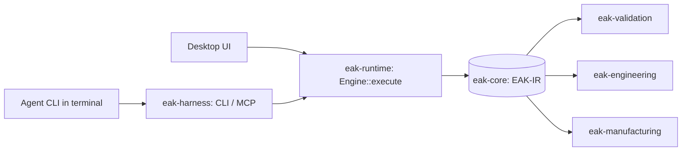

# Developer overview

Operational detail moved out of the README: install options, building from source, what is in the box, repository map, architecture notes and documentation index.

## Install options

One command installs EAK for your user (the prebuilt release; or, as a fallback, it builds **the current `main` source on your own computer**),
adds a launcher and starts it. Only the source fallback provisions Rust, Node.js and the native build libraries (asking
before anything needs administrator rights).

| Platform | Command |
|---|---|
| Linux (Debian/Ubuntu first) and macOS | `curl -fsSL https://raw.githubusercontent.com/NijoP/electronics-agent-kit-new-prototype/main/install.sh \| bash` |
| Windows 10/11 x64 (PowerShell) | `irm https://raw.githubusercontent.com/NijoP/electronics-agent-kit-new-prototype/main/install.ps1 \| iex` |

- Needs **network access**, and the **first build takes a long time** (the whole Rust dependency tree
  is compiled; plan for tens of minutes). Allow roughly 10 GB of disk (an estimate, not measured).
- The installers themselves have **not been run on real hardware**. Platform matrix:
  [docs/PLATFORM_SUPPORT.md](PLATFORM_SUPPORT.md).
- Pin a revision with `EAK_REF` (tag, branch or commit); the exact commit built is printed. Options,
  install paths, log locations and troubleshooting: [docs/INSTALL.md](INSTALL.md).
- **Prebuilt fast path (default):** when a verified `prebuilt-*` release exists, the installer downloads
  it and checks its SHA-256 before installing; otherwise it says so and builds the source. Force a mode
  with `--source` / `--prebuilt` (Linux/macOS: `... | bash -s -- --source`) or `EAK_INSTALL_MODE`
  (Windows: `$env:EAK_INSTALL_MODE='source'` first). It never installs the old v0.1.4. See
  [docs/INSTALL.md](INSTALL.md#prebuilt-release-the-default-fast-path-when-one-exists).

### Update

Run the same install command again. It rebuilds only if the commit changed, keeps the previous version
until the new one starts, and rolls back if the new one does not start. `EAK_FORCE=1` forces a rebuild.

### Uninstall

Removes only EAK's own app files and launcher, never your projects, settings or credentials. Add
`--clean-cache` (`EAK_CLEAN_CACHE=1`) to also delete build caches.

```bash
curl -fsSL https://raw.githubusercontent.com/NijoP/electronics-agent-kit-new-prototype/main/install.sh | bash -s -- --uninstall
```
```powershell
$env:EAK_UNINSTALL=1; irm https://raw.githubusercontent.com/NijoP/electronics-agent-kit-new-prototype/main/install.ps1 | iex
```

## Build from source manually

For developers with the toolchain already installed: stable Rust 1.80+, Node.js 20.19+ or 22.12+, and
the [Tauri system libraries](https://v2.tauri.app/start/prerequisites/) for your OS. No Python anywhere.
The scripts run `npm ci` and then one `npm run tauri -- build` (never a bare `cargo build --release`,
which skips the frontend build) and print the artifact path:

```bash
./scripts/build.sh      # Linux / macOS
```
```powershell
.\scripts\build.ps1     # Windows
```

Development loop: `cd apps/desktop && npm ci && npm run tauri dev`. Checks before a commit:

```bash
cargo fmt --all -- --check && cargo clippy --workspace --all-targets -- -D warnings \
  && cargo test --workspace --release && bash scripts/check-no-python.sh
```

More: [docs/DEVELOPMENT.md](DEVELOPMENT.md), [TESTING.md](../TESTING.md).

## What is in the box

States follow the [capability matrix](development/CAPABILITY_GAP_MATRIX.md). "Reviewed" means read
and statically checked only; nothing here is verified on the current tree.

| Capability | State |
|---|---|
| EAK-IR, typed commands, revisions, undo/redo, journal, crash recovery, project lock | Reviewed; ran before the build freeze |
| Schematic and PCB editors, Project Home, IDE shell | Reviewed; never seen in a real window |
| ERC, DRC, mechanical checks; fail-closed gates (unknown is not pass) | Reviewed; gaps listed in each report |
| Engineering calculators, netlist, native router and placer | Reviewed; heuristic, not signed off |
| Terminal engine (PTY sessions) and terminal workspace UI | PTY tests passed on Linux before the freeze; UI never run |
| `eak` CLI, MCP server, app endpoint for agents | Written; end-to-end tests never run; no agent trialled |
| Optional model providers (Anthropic, OpenAI-compatible, Gemini, Ollama) | Partial; no chat UI |
| Parts search (Distributor), simulation panel (ngspice), library | Partial; not checked against live services |
| 3D board viewer with component models | Written; never rendered |
| Gerber, drill, BOM, CPL, Fabricator preparation | Reviewed; always labelled DRAFT; no fabricator check |
| Agent approval UI, requirements capture, automatic component selection | Planned or partial |
| Independent engineering review, fabricator DFM sign-off | Not done |

## Repository map

| Path | Role |
|---|---|
| `crates/eak-core` | EAK-IR, schema, migration |
| `crates/eak-runtime` | `Engine::execute`, commands, journal, undo, recovery, project lock |
| `crates/eak-engineering` | Calculators, netlist, native router and placer |
| `crates/eak-validation` | ERC, DRC and mechanical checks, fail-closed gates |
| `crates/eak-manufacturing` | Gerber, drill, BOM, CPL, Fabricator preparation (DRAFT) |
| `crates/eak-simulation` | ngspice integration |
| `crates/eak-intelligence` | Optional model providers, typed tools, approvals, knowledge search |
| `crates/eak-terminal` | PTY sessions, process status, local control API |
| `crates/eak-harness` | `eak` CLI, MCP server and app endpoint for agents |
| `apps/desktop` | Tauri 2 shell and React/TypeScript UI (EDA and Terminal workspaces) |
| `scripts/`, `install.sh`, `install.ps1` | Build and source-install scripts |
| `docs/` | Architecture, ADRs, engineering rules, status records |

## Architecture in five bullets



- **One canonical EAK-IR** (`eak-core`). There is no second design representation.
- **Typed, revision-checked commands.** Every change goes through `Engine::execute`; a command that
  carries a stale revision is refused, and nothing writes project files directly.
- **Deterministic validation.** `eak-engineering` recomputes numbers and `eak-validation` runs ERC,
  DRC and mechanical checks. Every report lists what was not implemented and its limitations.
- **A harness for agents.** The `eak` CLI and MCP server expose the same typed commands as the UI, and
  calls are journalled under the agent's name. Agents run with their own installation and login.
- **A terminal workspace.** Real shells on pseudo-terminals with tabs, splits and process-derived
  status, owned by the backend so sessions survive switching workspaces.

## Documentation

- [docs/ARCHITECTURE.md](ARCHITECTURE.md) · [docs/PRODUCT_VISION.md](PRODUCT_VISION.md) · [ROADMAP.md](ROADMAP.md)
- Agents: [docs/AGENT_HARNESS.md](AGENT_HARNESS.md) · [docs/ENGINEERING_API.md](ENGINEERING_API.md) · [docs/TERMINAL_ARCHITECTURE.md](TERMINAL_ARCHITECTURE.md)
- Decisions (ADRs): [docs/decisions](decisions)
- State of the work: [STATUS.md](../STATUS.md) · [FEATURE_MATRIX.md](FEATURE_MATRIX.md) · [docs/development/NEXT_ACTION.md](development/NEXT_ACTION.md) · [docs/development/STATIC_REVIEW.md](development/STATIC_REVIEW.md)
- Install and platforms: [docs/INSTALL.md](INSTALL.md) · [docs/PLATFORM_SUPPORT.md](PLATFORM_SUPPORT.md) · [docs/SECURITY.md](SECURITY.md)

## Contributing

Read [AGENTS.md](../AGENTS.md): one IR, every mutation through the command engine, no Python, no
unverified claims. Every bug fix needs a regression test; shared-contract changes need an ADR in
[docs/decisions](decisions).


## Status log

The honest per-area status is in [STATUS.md](../STATUS.md) and the [capability matrix](development/CAPABILITY_GAP_MATRIX.md).
